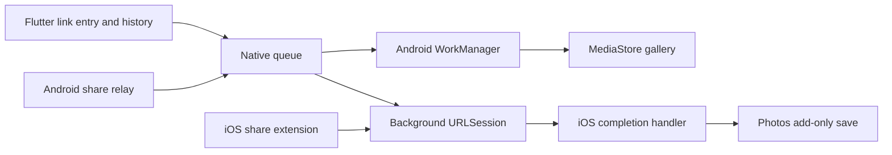

# maiDL

Flutter app for Android and iOS: paste a public video/image link, or share a link to **maiDL**, to download it into your media library.

## Implemented behavior

- Link entry with clipboard paste, progress, persistent history, retry and cancellation.
- Android share target queues native work without starting the Flutter UI. Downloads run through WorkManager and publish into MediaStore under `Pictures/maiDL` or `Movies/maiDL`; no storage permission is needed.
- iOS share extension queues a native background `URLSession` transfer. The containing app handles completion and adds the file to Photos using add-only authorization. The Flutter UI is not needed to finish a transfer.
- Direct HTTP(S) media URLs, redirects, and public HTML pages exposing a direct `og:video`, `og:image`, or video/source URL. Video metadata takes precedence over image metadata.

**Not a universal social-media downloader.** YouTube/TikTok/Instagram and other post links are not guaranteed to expose downloadable media. Pages may expose only a thumbnail. Authentication, private posts, DRM, HLS/DASH playlists and site-specific extraction are not supported. The OS Photos/gallery app must support the downloaded file's codec and container; a video MIME type alone does not guarantee Photos can import it. Only download material you have permission to save.

## Background behavior

Sharing explicitly to maiDL starts a save; there is no clipboard monitoring or interception of ordinary links. Initial Photos authorization on iOS requires user interaction. Android download notifications require notification permission on Android 13+; downloading does not require that permission.

“Background” is best-effort OS scheduling, not a promise of immediate completion. Network, battery policies, device storage and force-stop/force-quit affect delivery. iOS controls background transfer timing and may delay the containing app's completion callback. Failed jobs can be inspected and retried in maiDL. iOS completion is silent; successful files appear in Photos. Android uses progress/result notifications when permitted.

Clearing history or removing an entry does **not** delete saved media. Android partial downloads use private app storage before being copied into a pending MediaStore entry; publication occurs only after the copy succeeds. This temporarily requires additional disk space.

Android automatic retries resume only when the server provides a strong ETag and honors byte ranges; otherwise they restart safely. Explicit retries start a fresh attempt. On iOS, cancellation stops queued/downloading work; once a Photos commit starts, cancellation/removal must wait for it to finish. A crash between a successful library commit and recording completion can leave history incomplete; retrying then may duplicate an already-saved item.


## Run on Android

Requirements: Flutter/Dart matching `pubspec.yaml`, Android SDK, JDK 17, and an Android 10+ device/emulator (API 29 minimum).

```sh
flutter pub get
flutter run -d <android-device-id>
flutter build apk --release
```

APK: `build/app/outputs/flutter-apk/app-release.apk`.

The generated Gradle configuration signs release builds with the development/debug key for local installation. Configure your own signing key before distribution; the existing APK is not a store-signed release.

To use the share flow, share a **text/URL** link and select maiDL. Sharing an already-downloaded local file is not the same workflow and is not registered as a share target. HTTP URLs are permitted on Android; HTTPS is preferred.

## Run on iOS

A **Mac with Xcode, Apple SDKs and signing credentials is required**. iOS source and the embedded extension target are included; Windows cannot compile or validate Photos/share-extension behavior.

1. Run `flutter pub get`, then open `ios/Runner.xcworkspace` in Xcode.
2. Choose your signing team for both **Runner** and **ShareExtension**. Current bundle IDs are `app.maidl` and `app.maidl.ShareExtension`; use unique IDs for distribution.
3. Register/enable the **App Groups** capability on both targets with `group.app.maidl`. Provisioning profiles must include that entitlement. If renaming the group, update both entitlements and `ios/Shared/SharedConfig.swift` together.
4. Build the **Runner** scheme. The project already declares the extension dependency, shared-source membership, and **Embed App Extensions** phase; do not create a second extension target.
5. Install, open maiDL and allow add-only Photos access. In another app, share a public media URL, choose maiDL (enable it under the share sheet's More/Edit options if necessary), then return to the original app. Confirm the media eventually appears in Photos and the job finishes in history.

App and extension versions are synchronized automatically: the extension inherits Flutter's generated build settings. `pubspec.yaml` supplies the version; `--build-name` / `--build-number` override it for both targets. CI uses the workflow run number as the build number.

The app never needs read access to the entire Photos library. There is no public per-asset API for opening the Photos app, so iOS history does not offer Android's Open action.

## GitHub builds

Repository: [stardewjames/maiDL](https://github.com/stardewjames/maiDL).
Open [Actions → Build mobile apps](https://github.com/stardewjames/maiDL/actions/workflows/build.yml) to run a manual build or download artifacts from a completed run.

`.github/workflows/build.yml` runs on pushes to `main`, pull requests, and **Run workflow**. Flutter is pinned to `3.47.8`; third-party actions are pinned to commit hashes. No signing secrets are needed.

- **Android** uses Ubuntu and Java 17, resolves locked dependencies, analyzes/tests Flutter, builds a release APK, and runs the native JVM tests. Artifacts: `maidl-android-<run number>` and `maidl-android-tests-<run number>`.
- **iOS** uses a macOS runner with Xcode and builds `Runner.app` plus its embedded share extension with `--no-codesign`. It checks that the extension is present and its version/build number matches the app, then uploads `maidl-ios-unsigned-<run number>`.

Artifacts are retained for 14 days. The Android APK uses a development key, not a stable production signing key. **The unsigned iOS app is a compile-check artifact, not an installable IPA or TestFlight upload.** Producing an installable iOS distribution requires your Apple team, a signing certificate and matching provisioning profiles for both the app and extension, including the App Group capability. Do not commit certificates, profiles or Android keystores.

The iOS extension embedding phase intentionally precedes the Flutter scripts to avoid an Xcode build dependency cycle.

CI checks compilation and automated behavior; it does not replace the signed-device sharing/background/Photos acceptance scenarios below.


## Architecture



- `lib/src/core`: job model, link parsing, channel API and UI state mirror.
- `lib/src/ui`: link entry, job cards, permissions and history settings.
- `android/app/src/main/kotlin/app/maidl`: share intake, queue, worker, HTTP transfer and MediaStore publication.
- `ios/Shared`: App Group job records, link/media resolution, background sessions and Photos import (compiled into app and extension).
- `ios/Runner`: background event routing and Flutter channels.
- `ios/ShareExtension`: lightweight share-sheet UI and intake.

Native code owns job state. Channel names and payloads are documented in `lib/src/core/downloads_api.dart`.

## Verification

```sh
flutter analyze
flutter test
# From android/ (use gradlew.bat on Windows):
./gradlew :app:testDebugUnitTest :app:assembleRelease
```

The JVM tests exercise the actual Kotlin transfer engine against local HTTP responses: direct media, metadata resolution, exact range resume, ignored ranges, HTTP failures and unsupported content. Flutter tests cover state transitions, URL parsing, user input, permissions UI and small-screen layout.

Verification performed locally and in [the successful hosted build](https://github.com/stardewjames/maiDL/actions/runs/40954670017):

| Check | Result |
| --- | --- |
| Flutter static analysis | No issues |
| Flutter tests | 40 passed |
| Android JVM tests | 45 passed |
| Android release assembly | Passed |
| Kotlin downloader live smoke | Downloaded a 30,320-byte WebP over HTTPS; RIFF/WebP signature verified |
| Flutter UI browser smoke | Phone-size rendering, invalid-link feedback and Settings exercised |
| iOS Swift syntax / project wiring | All Swift sources parsed; Xcode target/source/embed configuration validated |
| Portable Swift media helpers | Compiled and ran URL, metadata, MIME and filename scenarios |
| Apple SDK release build | Passed on GitHub macOS; uploaded app contains `ShareExtension.appex`, with matching version `1.0.0` / build `3` |
| Signed-device iOS Photos flow | Not run: requires provisioning and a device |
| Android OS background/gallery flow | Not run: no Android device/emulator connected |

The Android APK uses development signing. Download the CI artifact from the successful run, or build locally to obtain `build/app/outputs/flutter-apk/app-release.apk`. CI artifacts use the workflow run number as their build number.


These checks do **not** prove Android OS scheduling/MediaStore integration or iOS Photos/share-extension lifecycle. Before distributing, exercise both platforms on devices, including: first-time authorization, share while the app is closed/open, a large video with the phone locked, network interruption, denied permissions, cancellation, low storage, unsupported codecs and force-quit/relaunch. Verify that canceled/failed jobs do not publish partial media and that clearing history leaves already-saved media untouched.
