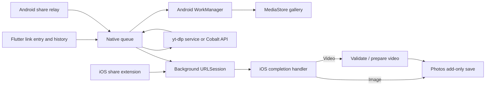

# maiDL

Flutter app for Android and iOS: paste a public video/image link, or share a link to **maiDL**, to download it into your media library.

## Implemented behavior

- Link entry with clipboard paste, progress, persistent history, retry and cancellation.
- Android share target queues native work without starting the Flutter UI. Downloads run through WorkManager and publish into MediaStore under `Pictures/maiDL` or `Movies/maiDL`; no storage permission is needed.
- iOS share extension queues a native background `URLSession` transfer. Native completion code checks/prepares videos, then adds media to Photos using add-only authorization. The Flutter UI does not need to be running.
- Direct HTTP(S) media URLs, redirects, and public HTML pages exposing a direct `og:video`, `og:image`, or video/source URL. Video metadata takes precedence over image metadata.
- TikTok, Instagram, YouTube/Shorts and X/Twitter links through a user-configured **yt-dlp service** or **Cobalt API**. The resolver returns a direct media URL before the normal background transfer starts.

**Social links require a resolver.** Without one, those apps' pages usually expose only a thumbnail or require login. With a resolver, public posts work, but private/login-gated posts, DRM, HLS/DASH playlists and live streams remain unsupported. YouTube through the bundled yt-dlp service prefers a single-file progressive stream (often 360p); Cobalt can offer different formats depending on its instance. Android's gallery must support the original downloaded format. Only download material you have permission to save.

## iOS video compatibility

Videos are prepared as **MP4 with H.264 video and AAC audio when audio is present**. Silent videos stay silent. The app checks actual track codecs, playability, duration and the container's file-type box; changing a filename to `.mp4` is not treated as conversion.

- Already-compatible MP4 files are reused unchanged, avoiding unnecessary CPU use and quality loss.
- Compatible H.264/AAC files in another container, such as MOV, are remuxed without recompression when possible.
- Other sources that AVFoundation can decode/export are converted with Apple's standard H.264 export presets, capped at 1080p. Transcoding can reduce quality and uses extra processing time and temporary disk space.
- Exported output is checked again for MP4/H.264/AAC, video playability, audio retention and display aspect/orientation before submission to Photos.
- Damaged, protected, audio-only and unsupported inputs fail explicitly. This does not add universal MKV/WebM decoding or a streaming downloader. FFmpeg is used only by CI to generate/probe fixtures; it is not shipped in the app.

“Preparing video” remains an active, cancelable state, distinct from the irreversible Photos commit. The downloaded source is retained during preparation. If iOS terminates preparation, a later app launch/refresh restarts it from that local source once the session's process ownership is available, without redownloading.

This targets broadly supported iOS media formats, not a guarantee that every file will import: Photos authorization, available storage, damaged media and OS lifecycle restrictions can still cause failure.


## Social link resolver

Settings → **Social links** chooses how TikTok, Instagram, YouTube/Shorts and X/Twitter links are turned into media URLs:

- **Off** (default): only direct media and pages exposing media metadata work.
- **yt-dlp service**: run the small companion service from `tool/resolver/` on a computer the phone can reach, then enter its URL, for example `http://192.168.1.20:8080`. See `tool/resolver/README.md`. The service extracts with yt-dlp and streams the file back through itself, which handles YouTube's signed, IP-bound URLs and referrer restrictions. It needs `ffmpeg` on the server for YouTube-style separate video/audio streams; those are streamed as fragmented MP4.
- **Cobalt API**: enter a cobalt.tools-compatible API base URL, for example a self-hosted instance such as `https://cobalt.example.com`. The app sends the social link to Cobalt and downloads the URL it returns. The public `https://api.cobalt.tools` now requires a JWT and will answer `error.api.auth.jwt.missing`; use a self-hosted instance or the yt-dlp service instead.

Only those four platforms' hosts are sent to the resolver; direct media URLs bypass it. Resolution happens before the transfer and appears as **Resolving link** in history. A failure leaves the job in history with the resolver's error and can be retried.

Security notes: the bundled yt-dlp service has no authentication, so run it on a trusted LAN or behind an authenticated reverse proxy; set `MAIDL_YTDLP_COOKIES` only on that machine. iOS allows HTTP resolver and media URLs (`NSAllowsArbitraryLoads`), and Android already allows cleartext traffic, so plain HTTP works for LAN resolvers. Prefer HTTPS when the resolver is reachable from untrusted networks.

## Background behavior

Sharing explicitly to maiDL starts a save; there is no clipboard monitoring or interception of ordinary links. Initial Photos authorization on iOS requires user interaction. Android download notifications require notification permission on Android 13+; downloading does not require that permission.

“Background” is best-effort OS scheduling, not a promise of immediate completion. Network, battery policies, device storage and force-stop/force-quit affect delivery. iOS controls background transfer timing and may delay the containing app's completion callback. Failed jobs can be inspected and retried in maiDL. iOS completion is silent; successful files appear in Photos. Android uses progress/result notifications when permitted.

Network transfer can continue through iOS's background transfer service, but video conversion is CPU work and has no unlimited background execution entitlement. iOS can suspend or terminate it; opening maiDL may be necessary to finish preparation. A share sheet waits for any already-started preparation/Photos work before completing its dismissal.

Clearing history or removing an entry does **not** delete saved media. Android partial downloads use private app storage before being copied into a pending MediaStore entry; publication occurs only after the copy succeeds. This temporarily requires additional disk space.

Android automatic retries resume only when the server provides a strong ETag and honors byte ranges; otherwise they restart safely. Explicit retries start a fresh attempt. On iOS, cancellation stops queued/downloading/preparing work; once a Photos commit starts, cancellation/removal must wait for it to finish. A crash between a successful library commit and recording completion can leave history incomplete; retrying then may duplicate an already-saved item.


## Run on Android

Requirements: Flutter/Dart matching `pubspec.yaml`, Android SDK, JDK 17, and an Android 10+ device/emulator (API 29 minimum).

```sh
flutter pub get
flutter run -d <android-device-id>
flutter build apk --release
```

APK: `build/app/outputs/flutter-apk/app-release.apk`.

The generated Gradle configuration signs release builds with the development/debug key for local installation. Configure your own signing key before distribution; the existing APK is not a store-signed release.

To use the share flow, share a **text/URL** link and select maiDL. Sharing an already-downloaded local file is not the same workflow and is not registered as a share target. HTTP URLs are permitted on Android; HTTPS is preferred.

## Run on iOS

A **Mac with Xcode, Apple SDKs and signing credentials is required**. iOS source and the embedded extension target are included; Windows cannot compile or validate Photos/share-extension behavior.

1. Run `flutter pub get`, then open `ios/Runner.xcworkspace` in Xcode.
2. Choose your signing team for both **Runner** and **ShareExtension**. Current bundle IDs are `app.maidl` and `app.maidl.ShareExtension`; use unique IDs for distribution.
3. Register/enable the **App Groups** capability on both targets with `group.app.maidl`. Provisioning profiles must include that entitlement. If renaming the group, update both entitlements and `ios/Shared/SharedConfig.swift` together. This is required only for the seamless share-sheet flow; builds without the entitlement use the fallback described below.
4. Build the **Runner** scheme. The project already declares the extension dependency, shared-source membership, and **Embed App Extensions** phase; do not create a second extension target.
5. Install, open maiDL and allow add-only Photos access. In another app, share a public media URL, choose maiDL (enable it under the share sheet's More/Edit options if necessary), then return to the original app. Confirm the media eventually appears in Photos and the job finishes in history.

App and extension versions are synchronized automatically: the extension inherits Flutter's generated build settings. `pubspec.yaml` supplies the version; `--build-name` / `--build-number` override it for both targets. CI uses the workflow run number as the build number.

To produce an unsigned IPA locally without distribution credentials:

```sh
flutter build ios --release --no-codesign
mkdir -p build/ipa/Payload
cp -R build/ios/iphoneos/Runner.app build/ipa/Payload/Runner.app
(cd build/ipa && zip -qry maidl-unsigned.ipa Payload)
```

The resulting `build/ipa/maidl-unsigned.ipa` contains the app and its embedded extension. It is unsigned, so re-sign it with your Apple team and provisioning profiles (for example with Sideloadly or AltStore) before installing; TestFlight/App Store upload requires a normally signed build.

### Running without the App Group entitlement

maiDL checks at runtime whether `group.app.maidl` resolves. If the signing profile does not grant it, the app:

- stores jobs in its own `Application Support/maidl` directory instead of the shared container, so links entered in the app download normally;
- makes the share extension copy the normalized link to a custom pasteboard type and ask you to open maiDL, which imports the link when it becomes active.

The share flow therefore requires opening maiDL manually in this mode: iOS does not let a share extension launch its containing app without shared storage. iOS may ask you to allow pasting when maiDL reads the handoff. Background transfers, video preparation and Photos saving still run in the app. When a signed build grants `group.app.maidl`, both processes switch back to the shared queue automatically; there is no toggle to set.

The app never needs read access to the entire Photos library. There is no public per-asset API for opening the Photos app, so iOS history does not offer Android's Open action.

## GitHub builds

Public repository: [stardewjames/maiDL](https://github.com/stardewjames/maiDL).
Open [Actions → Build mobile apps](https://github.com/stardewjames/maiDL/actions/workflows/build.yml) to run a manual build or download artifacts from a completed run.

`.github/workflows/build.yml` runs on pushes to `main`, pull requests, **Run workflow**, and tags matching `v*`. Flutter is pinned to `3.47.8`; third-party actions are pinned to commit hashes. No signing secrets are needed. For tag builds the tag without the leading `v` becomes the app version, so `v1.0.0` builds `1.0.0`; a semver suffix such as `-rc.1` only marks the GitHub prerelease, keeping the app version numeric for Apple.

- **Android** uses Ubuntu and Java 17, resolves locked dependencies, analyzes/tests Flutter, builds a release APK, and runs the native JVM tests. Artifacts: `maidl-android-<run number>` (`app-release.apk`) and `maidl-android-tests-<run number>`.
- **iOS** uses a macOS runner with Xcode. It compiles the shipping storage code and verifies the no-App-Group job store with `bash tool/verify_ios_storage.sh`, then `bash tool/verify_ios_video.sh` generates fixtures and compiles/runs the shipping AVFoundation preparation helper. It verifies unchanged MP4, lossless MOV remux, disguised MOV, HEVC and ProRes/PCM conversion, rotation, silent video, invalid input and cancellation. Then it builds `Runner.app` plus its embedded share extension with `--no-codesign`, checks matching app/extension versions, and packages `maidl-<version>-ios-unsigned.ipa` in `Payload/` layout with the extension inside. Artifact: `maidl-ios-<run number>`.

Artifacts are retained for 14 days. The Android APK uses a development key, not a stable production signing key. **The iOS IPA is unsigned, so it must be re-signed with your Apple team, a signing certificate and matching provisioning profiles for both the app and extension before installing or uploading.** Include the App Group capability only if you want the seamless share flow; without it maiDL uses the app-local/clipboard fallback. Do not commit certificates, profiles or Android keystores.

### Releases

Pushing a tag such as `v1.0.0` runs the build jobs and then publishes a GitHub Release containing `maidl-<version>-android.apk` and `maidl-<version>-ios-unsigned.ipa`.

```sh
git tag v1.0.0
git push origin v1.0.0
```

The release is marked as a prerelease while the 1.0 line is being validated (`RELEASE_PRERELEASE: 'true'` in the workflow); tags with a semver prerelease suffix are always prereleases. Set `RELEASE_PRERELEASE` to `'false'` to publish a stable release. Re-running a tag build uploads assets to the existing release instead of failing.

The iOS extension embedding phase intentionally precedes the Flutter scripts to avoid an Xcode build dependency cycle.

CI checks compilation and automated behavior; it does not replace the signed-device sharing/background/Photos acceptance scenarios below.


## Architecture



- `lib/src/core`: job model, link parsing, resolver settings, channel API and UI state mirror.
- `lib/src/ui`: link entry, job cards, permissions and history settings.
- `android/app/src/main/kotlin/app/maidl`: share intake, queue, resolver client, worker, HTTP transfer and MediaStore publication.
- `ios/Shared`: job records (App Group when entitled, app-local otherwise), link/media resolution, resolver client, background sessions, `VideoCompatibility.swift` preparation and Photos import (compiled into app and extension).
- `ios/Runner`: background event routing and Flutter channels.
- `ios/ShareExtension`: lightweight share-sheet UI and intake.

Native code owns job state. Channel names and payloads are documented in `lib/src/core/downloads_api.dart`.

## Verification

```sh
flutter analyze
flutter test
# From android/ (use gradlew.bat on Windows):
./gradlew :app:testDebugUnitTest :app:assembleRelease
# From repository root on macOS with Xcode (installs FFmpeg via Homebrew if absent):
bash tool/verify_ios_storage.sh
bash tool/verify_ios_video.sh
```

The JVM tests exercise the actual Kotlin transfer engine against local HTTP responses: direct media, metadata resolution, exact range resume, ignored ranges, HTTP failures and unsupported content. Flutter tests cover state transitions, URL parsing, user input, permissions UI, video-preparation state and small-screen layout.

Verification performed locally and in [the successful hosted build](https://github.com/stardewjames/maiDL/actions/runs/40962761772):

| Check | Result |
| --- | --- |
| Flutter static analysis | No issues |
| Flutter tests | 42 passed |
| Android JVM tests | Passed |
| Android release assembly | Passed |
| Kotlin downloader live smoke | Downloaded a 30,320-byte WebP over HTTPS; RIFF/WebP signature verified |
| Flutter UI browser smoke | Phone-size rendering, invalid-link feedback, Settings, and cancelable “Preparing video” vs. non-cancelable “Adding to Photos” exercised |
| iOS video preparation (macOS AVFoundation) | Compatible MP4 kept byte-identical; H.264/AAC MOV remuxed without re-encoding; disguised MOV, HEVC, ProRes/PCM, rotated and silent sources converted to verified H.264/AAC MP4; fragmented MP4 prepared; corrupt and audio-only input rejected; cancellation leaves no output |
| iOS Swift syntax / project wiring | All Swift sources parsed; Xcode target/source/embed configuration validated |
| Portable Swift media helpers | Compiled and ran URL, metadata, MIME and filename scenarios |
| iOS storage fallback | Compiled and ran the shipping `JobStore` on macOS; local Application Support root, shared-container root and save/get/remove round-trip passed |
| Social resolver parsing | Android JVM tests cover supported hosts, Cobalt tunnel/picker/error responses, yt-dlp responses and invalid endpoints |
| yt-dlp service smoke | Local direct-URL proxy round-trip matched bytes; YouTube adaptive stream resolved and merged to a playable fragmented MP4 via ffmpeg |
| Apple SDK release build | Passed on GitHub macOS; the app contains `ShareExtension.appex` with matching version `1.0.0` / build `6`. IPA packaging and prerelease publishing run on the next tag build |
| Signed-device iOS Photos flow | Not run: requires provisioning and a device |
| App Group-less share handoff | Not run: requires a signed sideloaded device; storage and compile paths verified |
| Android OS background/gallery flow | Not run: no Android device/emulator connected |

The Android APK uses development signing. Download the CI artifact from the successful run, or build locally to obtain `build/app/outputs/flutter-apk/app-release.apk`. CI artifacts use the workflow run number as their build number.


These checks do **not** prove Android OS scheduling/MediaStore integration or iOS Photos/share-extension lifecycle. Before distributing, exercise both platforms on devices, including: first-time authorization, share while the app is closed/open, a large video with the phone locked, network interruption, denied permissions, cancellation, low storage, unsupported codecs and force-quit/relaunch. Verify that canceled/failed jobs do not publish partial media and that clearing history leaves already-saved media untouched.
